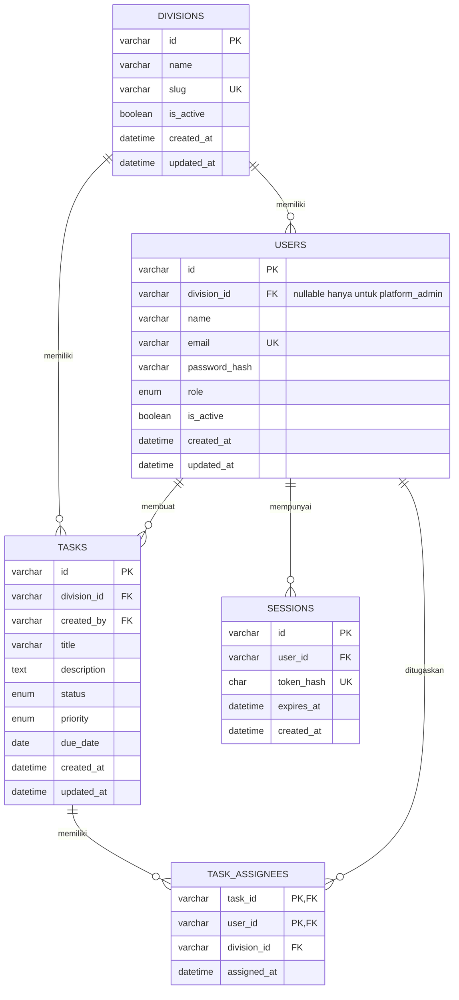

# BE.md — Backend Planning Kanban Management System

Dokumen ini adalah acuan implementasi backend untuk Kanban multi-divisi berbasis Next.js App Router, Hono, Drizzle ORM, dan MySQL 8.0.30.

## 1. Tujuan Backend

Backend bertanggung jawab atas:

1. Authentication dan session pengguna.
2. Authorization berdasarkan role dan divisi.
3. Pengelolaan divisi secara dinamis.
4. Pengelolaan task Kanban.
5. Pengelolaan anggota divisi.
6. Penyimpanan dan integritas data.

Backend adalah sumber kebenaran untuk identitas, role, divisi, dan izin. Frontend/Zustand tidak boleh dipercaya untuk menentukan hak akses.

## 2. Stack Teknologi

| Komponen | Teknologi | Tanggung jawab |
|---|---|---|
| Backend framework | Hono | API dan middleware backend |
| Language | TypeScript | Bahasa implementasi |
| Host / adapter | Next.js App Router + `@hono/vercel` | Meneruskan request `/api/*` ke Hono |
| Database | MySQL 8.0.30 | Penyimpanan relasional |
| ORM | Drizzle ORM | Schema, query, dan migration |
| Driver | `mysql2` | Koneksi Node.js ke MySQL |
| Validation | Zod + `@hono/zod-validator` | Validasi request |
| Authentication | Server-side session + `HttpOnly` cookie | Mempertahankan login |
| Password hashing | Argon2id (`argon2`) | Hash password |
| Migration | Drizzle Kit | Generate dan menjalankan migration |
| Seed runner | `tsx` | Menjalankan seeder TypeScript |

Dependency project sudah dipasang pada root Next.js. Jangan membuat project/backend package terpisah.

## 3. Business Rules Final

### 3.1 Organisasi dan divisi

1. Jumlah divisi dinamis; tidak dibatasi Marketing dan IT.
2. Marketing dan IT hanya contoh divisi awal, bukan daftar tetap atau batas sistem.
3. Divisi disimpan di tabel `divisions` dan dapat dibuat melalui fitur Division Management.
4. Divisi tidak dihapus secara fisik melalui operasi normal. Divisi dapat dinonaktifkan (`is_active = false`) agar riwayat task dan anggota tetap terjaga.
5. Divisi yang nonaktif tidak menerima task atau anggota baru. Pengguna divisi nonaktif tidak dapat menggunakan fitur kerja sampai divisi diaktifkan kembali.

### 3.2 Role pengguna

Sistem menggunakan tiga role:

| Role | Division ID | Cakupan |
|---|---|---|
| `platform_admin` | `NULL` | Mengelola organisasi dan divisi; bukan otomatis pembaca seluruh task |
| `division_admin` | Wajib terisi | Mengelola task dan anggota dalam satu divisi |
| `member` | Wajib terisi | Mengelola task sesuai aturan Member dalam satu divisi |

Aturan:
- Akun pertama `platform_admin` dibuat melalui seeder/konfigurasi deployment.
- Platform Admin dapat membuat, mengubah, mengaktifkan, dan menonaktifkan divisi.
- Platform Admin dapat membuat akun Division Admin untuk divisi yang aktif.
- Division Admin hanya mengelola anggota dan task divisinya sendiri.
- Division Admin tidak dapat membuat divisi atau mengelola user divisi lain.
- Member tidak dapat mengelola anggota atau divisi.
- MVP tidak memerlukan pemilihan divisi bebas ketika login.

### 3.3 User dan divisi

1. Satu user hanya tergabung dalam satu divisi.
2. `platform_admin` tidak tergabung dalam divisi (`division_id = NULL`).
3. `division_admin` dan `member` wajib memiliki `division_id`.
4. User non-platform hanya dapat dibuat dalam divisi yang aktif.
5. User dinonaktifkan secara soft-disable (`is_active = false`), bukan dihapus fisik sebagai operasi rutin.

### 3.4 Task dan assignee

1. Setiap task dimiliki tepat oleh satu divisi dan mempunyai satu pembuat (`created_by`).
2. Satu task dapat memiliki nol, satu, atau banyak assignee melalui tabel penghubung `task_assignees`.
3. Pembuat dan seluruh assignee harus berasal dari divisi yang sama dengan task.
4. Assignee wajib merupakan user aktif.
5. Status: `todo`, `in_progress`, `done`.
6. Prioritas: `low`, `medium`, `high`.
7. Backend mengisi `division_id` dan `created_by` dari session; jangan percaya nilai dari request body/query.

### 3.5 Hak akses task

| Aksi | Platform Admin | Division Admin | Member |
|---|---|---|---|
| Mengelola divisi | Ya | Tidak | Tidak |
| Membuat Division Admin | Ya | Tidak | Tidak |
| Melihat task | Tidak otomatis; tidak termasuk MVP | Semua task divisinya | Semua task divisinya |
| Membuat task | Tidak | Ya | Ya |
| Mengedit task | Tidak | Semua task divisinya | Task yang dibuat sendiri atau ditugaskan kepadanya |
| Menghapus task | Tidak | Semua task divisinya | Hanya task yang dibuat sendiri |
| Mengelola anggota | Tidak otomatis; mengelola admin divisi saja | Anggota divisinya | Tidak |
| Mengakses divisi lain | Organisasi saja, bukan isi task | Tidak | Tidak |

Menjadi assignee saja tidak memberikan izin kepada Member untuk menghapus task.

## 4. Arsitektur Request

```text
Browser / Next.js UI
        |
        v
Zustand Store / FE API client
        | HTTP + HttpOnly Session Cookie
        v
Next.js App Router catch-all API route
        v
Hono Application
        +--> Authentication Middleware
        +--> Role / Division Authorization
        +--> Route Handler
        +--> Service / Business Logic
        v
Drizzle ORM
        v
MySQL 8.0.30
```

Semua endpoint privat memeriksa session. Scope divisi selalu berasal dari user yang diverifikasi backend.

## 5. Database Design

### 5.1 Tabel inti

MVP memakai lima tabel inti:

1. `divisions`
2. `users`
3. `tasks`
4. `task_assignees`
5. `sessions`

Drizzle juga membuat tabel internal `__drizzle_migrations` untuk riwayat migration.

### 5.2 ERD



ID entitas menggunakan UUID dalam `VARCHAR(36)`. Semua kolom foreign key harus memiliki tipe dan collation yang kompatibel.

### 5.3 `divisions`

| Kolom | Tipe | Aturan |
|---|---|---|
| `id` | `VARCHAR(36)` | PK, UUID |
| `name` | `VARCHAR(100)` | Wajib |
| `slug` | `VARCHAR(100)` | Wajib, unique |
| `is_active` | `BOOLEAN` | Wajib, default `true` |
| `created_at` | `DATETIME` | Default waktu sekarang |
| `updated_at` | `DATETIME` | Default waktu sekarang; diperbarui aplikasi saat update |

Tidak ada daftar divisi yang di-hardcode sebagai batas sistem. Seeder awal hanya membuat Platform Admin; divisi dibuat oleh Platform Admin melalui API.

### 5.4 `users`

| Kolom | Tipe | Aturan |
|---|---|---|
| `id` | `VARCHAR(36)` | PK, UUID |
| `division_id` | `VARCHAR(36)` | Nullable untuk `platform_admin`; FK ke `divisions.id` |
| `name` | `VARCHAR(120)` | Wajib |
| `email` | `VARCHAR(191)` | Wajib, unique, lowercase |
| `password_hash` | `VARCHAR(255)` | Wajib, Argon2id |
| `role` | `ENUM('platform_admin','division_admin','member')` | Wajib |
| `is_active` | `BOOLEAN` | Wajib, default `true` |
| `created_at` | `DATETIME` | Default waktu sekarang |
| `updated_at` | `DATETIME` | Diperbarui aplikasi saat update |

Constraint:
- `UNIQUE(email)`.
- `UNIQUE(id, division_id)` untuk target composite foreign key task.
- CHECK: `platform_admin` harus memiliki `division_id IS NULL`; `division_admin` dan `member` harus memiliki `division_id IS NOT NULL`.
- Index `division_id` dan `(division_id, role, is_active)`.

### 5.5 `tasks`

Kolom tetap seperti migration pertama:
- `id VARCHAR(36)` PK.
- `division_id VARCHAR(36)` FK ke divisions.
- `created_by VARCHAR(36)`.
- `title VARCHAR(160)` wajib.
- `description TEXT` opsional.
- `status ENUM('todo','in_progress','done')` default `todo`.
- `priority ENUM('low','medium','high')` default `medium`.
- `due_date DATE` opsional.
- `created_at`, `updated_at`.

Composite FK `(created_by, division_id)` mengarah ke `users(id, division_id)` untuk memastikan pembuat berasal dari divisi task.

### 5.6 `task_assignees`

- `task_id VARCHAR(36)`.
- `user_id VARCHAR(36)`.
- `division_id VARCHAR(36)`.
- `assigned_at DATETIME`.
- Composite primary key `(task_id, user_id)`.
- Composite FK `(task_id, division_id)` ke `tasks(id, division_id)`.
- Composite FK `(user_id, division_id)` ke `users(id, division_id)`.

Constraint tersebut menjaga penugasan lintas divisi tetap ditolak oleh database. Service juga harus mengecek assignee aktif.

### 5.7 `sessions`

- `id VARCHAR(36)` PK.
- `user_id VARCHAR(36)` FK ke users.
- `token_hash CHAR(64)` unique; hash SHA-256 dari token acak.
- `expires_at DATETIME`.
- `created_at DATETIME`.

Cookie browser menyimpan token acak asli dengan atribut aman; database hanya menyimpan hash. Token tidak disimpan di Zustand/localStorage.

### 5.8 Aturan status divisi

- Divisi aktif dapat menerima Division Admin, Member, dan task.
- Divisi nonaktif tidak dapat menerima user/task baru.
- User dari divisi nonaktif tidak dapat mengakses endpoint kerja; backend mengembalikan status penolakan yang konsisten.
- Platform Admin tetap dapat melihat dan mengaktifkan kembali record divisi.
- Divisi tidak dihapus fisik bila masih memiliki user/task.

## 6. Authentication dan Session

### `POST /api/auth/login`
1. Validasi email/password.
2. Cari user dan pastikan `is_active`.
3. Untuk user non-platform, pastikan divisinya aktif.
4. Verifikasi password Argon2id.
5. Buat token acak yang kuat.
6. Simpan SHA-256 token ke `sessions` bersama expiry.
7. Set cookie `HttpOnly`, `Secure` di production, `SameSite` yang sesuai, `Path=/`, dan expiry.
8. Kembalikan profil aman tanpa password hash atau token.

### `GET /api/auth/me`
Verifikasi cookie/session, user aktif, dan status divisi untuk user non-platform. Kembalikan `id`, `name`, `email`, `role`, serta info divisi bila ada.

### `POST /api/auth/logout`
Revoke session dan hapus cookie.

Keamanan tambahan: HTTPS production, mitigasi CSRF untuk cookie-based mutation, rate limit login, jangan log password/token, revoke session saat akun dinonaktifkan.

## 7. Middleware dan Authorization

- `auth.middleware.ts`: validasi cookie, hash token, cari session, expiry, user aktif, dan status divisi.
- `permission.middleware.ts`: pemeriksaan role.
- Division scope untuk Division Admin/Member berasal dari session user.
- Platform Admin hanya diberi akses ke endpoint organisasi/divisi dan pembuatan Division Admin; bukan otomatis akses ke task semua divisi.
- Cross-division resource dapat dikembalikan sebagai `404` agar keberadaan resource tidak bocor; gunakan kebijakan ini secara konsisten.

## 8. API Contract

Format sukses:

```json
{ "success": true, "message": "Request berhasil", "data": {} }
```

Format error:

```json
{ "success": false, "message": "Request tidak dapat diproses", "errors": [] }
```

### 8.1 Auth

| Method | Endpoint | Akses |
|---|---|---|
| POST | `/api/auth/login` | Publik |
| POST | `/api/auth/logout` | Login |
| GET | `/api/auth/me` | Login |

### 8.2 Division Management

| Method | Endpoint | Akses | Fungsi |
|---|---|---|---|
| GET | `/api/divisions` | Platform Admin | Daftar seluruh divisi |
| POST | `/api/divisions` | Platform Admin | Membuat divisi |
| GET | `/api/divisions/:id` | Platform Admin | Detail divisi |
| PATCH | `/api/divisions/:id` | Platform Admin | Mengubah nama/slug |
| PATCH | `/api/divisions/:id/status` | Platform Admin | Aktivasi/nonaktif divisi |
| POST | `/api/divisions/:id/admins` | Platform Admin | Membuat Division Admin |

Contoh POST `/api/divisions`:

```json
{ "name": "Finance", "slug": "finance" }
```

Contoh pembuatan Division Admin: request memuat `name`, `email`, dan password sementara/awal yang divalidasi; backend mengambil `division_id` dari parameter route setelah memastikan divisi aktif. Password di-hash Argon2id. Jangan menerima role atau division_id bebas dari request body.

### 8.3 Tasks

| Method | Endpoint | Akses |
|---|---|---|
| GET | `/api/tasks` | Division Admin/Member yang login |
| GET | `/api/tasks/:id` | Scope divisi |
| POST | `/api/tasks` | Division Admin/Member |
| PATCH | `/api/tasks/:id` | Izin task |
| DELETE | `/api/tasks/:id` | Izin task |

Query: `q`, `status`, `priority`, `assigneeId`. Scope divisi diterapkan sebelum filter.

Contoh POST task:

```json
{
  "title": "Membuat laporan bulanan",
  "description": "Menyiapkan laporan divisi",
  "status": "todo",
  "priority": "medium",
  "dueDate": "2026-12-10",
  "assigneeIds": ["uuid-user-1", "uuid-user-2"]
}
```

`divisionId` dan `createdBy` tidak diterima sebagai sumber otoritatif dari client. Pada PATCH, `assigneeIds` tidak dikirim berarti tidak berubah; array kosong berarti semua assignment dihapus; array berisi ID berarti mengganti assignment setelah validasi dan dalam transaksi.

### 8.4 Member Management

| Method | Endpoint | Akses | Fungsi |
|---|---|---|---|
| GET | `/api/members` | Division Admin | Daftar member divisinya |
| POST | `/api/members` | Division Admin | Membuat Member pada divisinya |
| PATCH | `/api/members/:id` | Division Admin | Mengubah field yang diizinkan |
| PATCH | `/api/members/:id/status` | Division Admin | Aktif/nonaktif Member |

Division Admin hanya boleh membuat role `member`; tidak boleh membuat Admin divisi lain, mengubah role menjadi `division_admin`, atau memindahkan divisi.

## 9. Seeder dan Inisialisasi Organisasi

Seeder awal tidak mengunci daftar divisi. Seeder hanya membuat akun `platform_admin` dari environment:

- `SEED_PLATFORM_ADMIN_NAME`
- `SEED_PLATFORM_ADMIN_EMAIL`
- `SEED_PLATFORM_ADMIN_PASSWORD`

Password minimal 12 karakter untuk development dan di-hash Argon2id. Seeder harus idempotent: jika email sudah ada dengan role/division yang sesuai, jangan duplikasi; jika konfigurasi tidak cocok, hentikan dengan error yang jelas. Jangan mencetak password atau hash.

Divisi pertama dan berikutnya dibuat oleh Platform Admin melalui `/api/divisions`. Marketing dan IT dapat ditambahkan manual melalui API sebagai data awal bila memang dibutuhkan, tetapi bukan hard-coded wajib.

## 10. Urutan Pengerjaan

### BE-0 — Desain
- [x] MySQL 8.0.30 + Drizzle ORM.
- [x] Satu user hanya satu divisi.
- [x] Multi-assignee satu divisi.
- [x] Platform Admin, Division Admin, Member.
- [x] Divisi dinamis, tidak dibatasi Marketing/IT.
- [ ] Samakan API contract dengan FE.

### BE-1 — Setup dan Database
- [x] Next.js dan Hono berjalan.
- [x] Koneksi MySQL dan Drizzle diuji.
- [x] Lima tabel inti dimigrasikan.
- [x] Foreign key diperiksa.
- [ ] Tambahkan `divisions.is_active`.
- [ ] Ubah `users.division_id` menjadi nullable.
- [ ] Ubah enum role menjadi tiga role.
- [ ] Tambahkan CHECK role/division.
- [ ] Generate dan review migration lanjutan.
- [ ] Jalankan migration lanjutan.
- [ ] Seeder Platform Admin.
- [ ] Tes data awal.

### BE-2 — Authentication
- [ ] Login Argon2id.
- [ ] Session token + hash.
- [ ] Cookie aman.
- [ ] `/api/auth/me`.
- [ ] Logout/revoke.
- [ ] Middleware auth.

### BE-3 — Division Management dan Authorization
- [ ] Role middleware tiga role.
- [ ] CRUD/status divisi untuk Platform Admin.
- [ ] Pembuatan Division Admin oleh Platform Admin.
- [ ] Cek status divisi.
- [ ] Cegah akses lintas divisi.

### BE-4 — Task CRUD
- [ ] GET/POST/PATCH/DELETE tasks.
- [ ] Search dan filter.
- [ ] Multi-assignee dalam transaksi.
- [ ] Izin edit Member dan delete Member.

### BE-5 — Member Management
- [ ] Daftar anggota per divisi.
- [ ] Membuat Member.
- [ ] Update field yang diizinkan.
- [ ] Aktivasi/nonaktif dan revoke session.

### BE-6 — Security, Testing, Deployment
- [ ] Test auth, role, divisi, CRUD, multi-assignee.
- [ ] CSRF/CORS/cookie/HTTPS.
- [ ] Typecheck, test, build.
- [ ] Tidak commit `.env` atau kredensial.

## 11. Test Case Wajib

- Platform Admin dapat membuat divisi baru dengan slug unik.
- Slug duplikat ditolak.
- Platform Admin dapat menonaktifkan dan mengaktifkan kembali divisi.
- Divisi nonaktif tidak menerima user/task baru.
- Platform Admin tidak mempunyai `division_id`.
- Division Admin dan Member wajib memiliki `division_id`.
- Division Admin tidak dapat mengelola divisi lain.
- Member tidak dapat mengakses endpoint Division Management.
- Division Admin hanya melihat task dan anggota divisinya.
- Member hanya dapat mengedit task buatan sendiri/yang ditugaskan kepadanya.
- Member hanya dapat menghapus task yang dibuat sendiri.
- Assignee harus aktif dan berasal dari divisi task.
- Pengguna tidak dapat mengganti division scope melalui body/query.
- Session invalid/expired/revoked ditolak.

## 12. Struktur Folder Backend

```text
src/
├── app/
│   └── api/
│       └── [[...route]]/
│           └── route.ts
├── server/
│   ├── app.ts
│   ├── types.ts
│   ├── routes/
│   │   ├── health.routes.ts
│   │   ├── auth.routes.ts
│   │   ├── division.routes.ts
│   │   ├── task.routes.ts
│   │   └── member.routes.ts
│   ├── middleware/
│   │   ├── auth.middleware.ts
│   │   └── permission.middleware.ts
│   ├── services/
│   │   ├── auth.service.ts
│   │   ├── division.service.ts
│   │   ├── task.service.ts
│   │   └── member.service.ts
│   └── validators/
│       ├── auth.schema.ts
│       ├── division.schema.ts
│       ├── task.schema.ts
│       └── member.schema.ts
└── db/
    ├── index.ts
    ├── seed.ts
    └── schema/
        ├── index.ts
        ├── divisions.ts
        ├── users.ts
        ├── tasks.ts
        ├── task-assignees.ts
        └── sessions.ts

drizzle/
drizzle.config.ts
.env.local
.env.example
```

## 13. Acceptance Criteria

- [ ] Jumlah divisi tidak dibatasi hard-coded.
- [ ] Platform Admin menjadi akun bootstrap dan dapat mengelola divisi.
- [ ] Division Admin hanya mengelola satu divisinya.
- [ ] Member hanya mengakses task sesuai aturan dan divisinya.
- [ ] `division_id` nullable hanya untuk Platform Admin dan dipaksa melalui CHECK constraint.
- [ ] Divisi dapat dinonaktifkan tanpa menghapus riwayat.
- [ ] Task memiliki multi-assignee melalui `task_assignees`.
- [ ] Database menolak assignment lintas divisi.
- [ ] Semua endpoint privat memverifikasi session.
- [ ] FE hanya menerima data sesuai API contract dan tidak menjadi sumber keputusan authorization.
